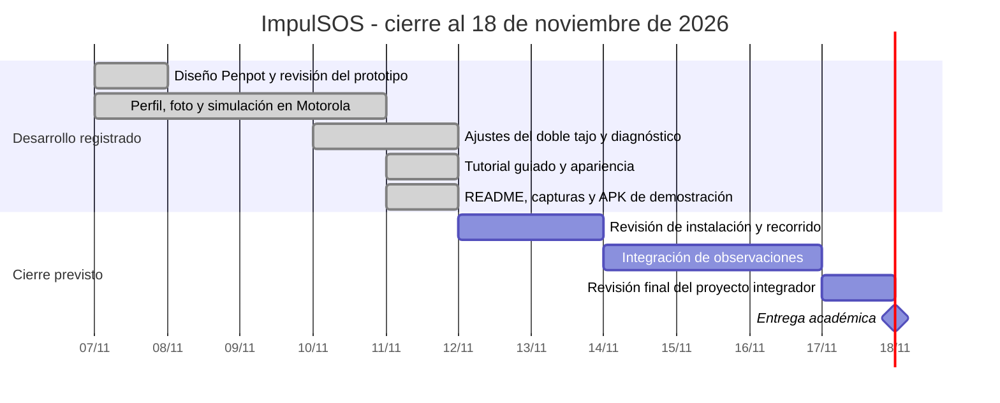
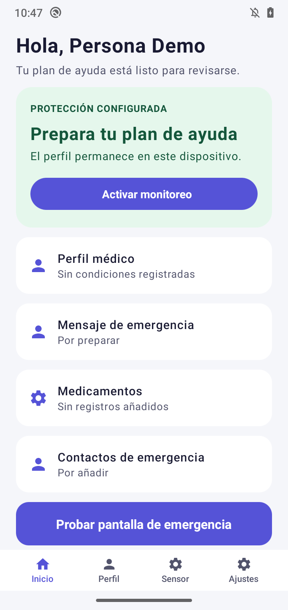
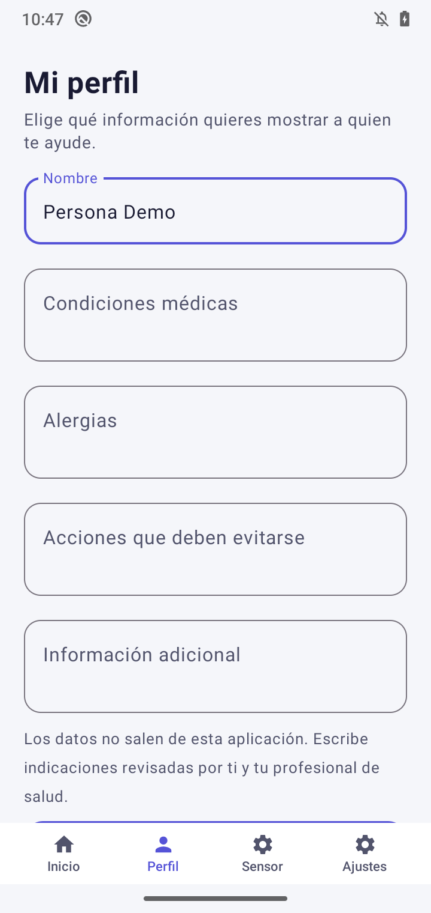
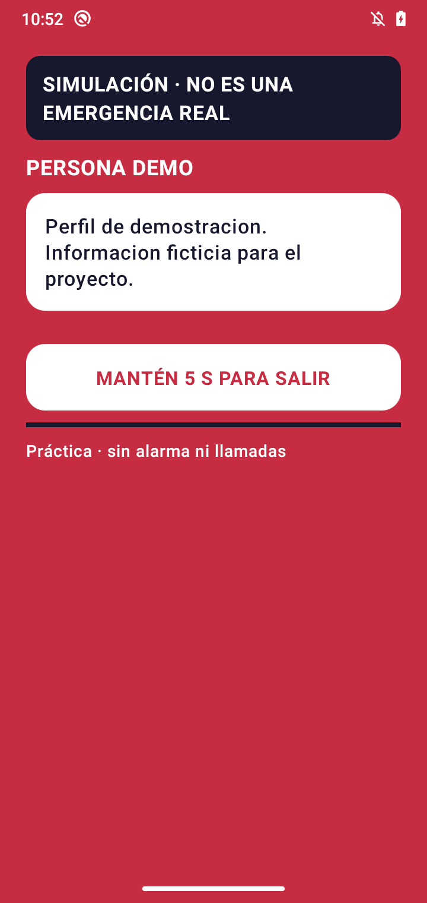
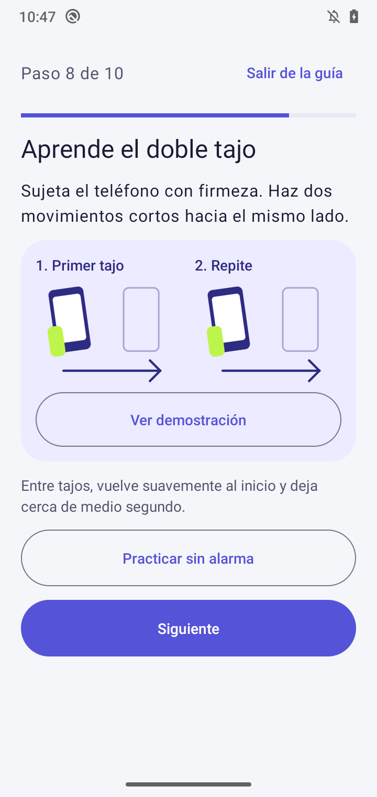
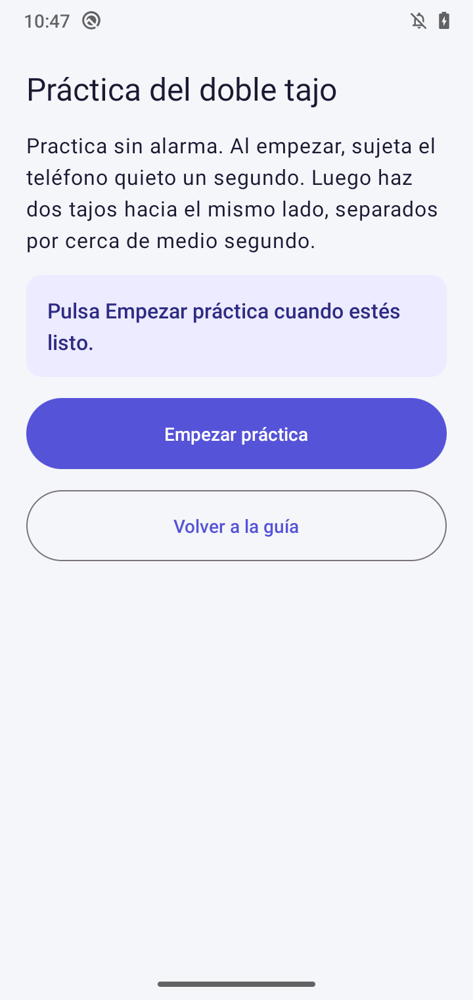
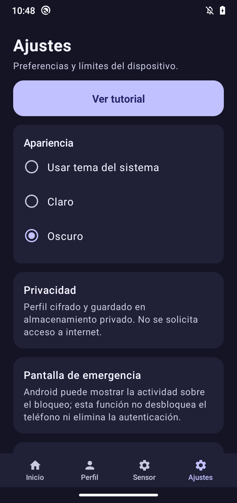
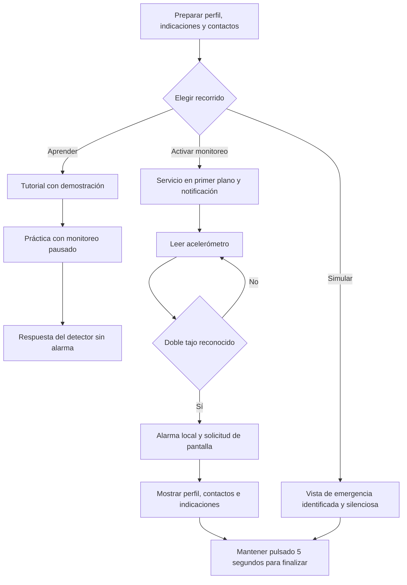
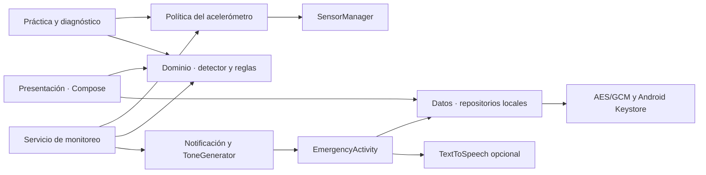

# ImpulSOS

**Aplicación Android de asistencia local en emergencias médicas mediante un doble tajo del teléfono.**

ImpulSOS permite preparar un perfil de emergencia y presentar esa información a quien pueda prestar ayuda. Con el monitoreo activo, un gesto deliberado puede activar una alarma local y solicitar la apertura de la pantalla de emergencia. La versión académica **0.1.7** fue probada en un **Motorola one con Android 10**.

> ImpulSOS es un prototipo de apoyo. La detección es experimental y puede equivocarse. Para una emergencia real, sigue los canales de atención de tu localidad.

[Descargar ImpulSOS 0.1.7 para Android](https://github.com/Ang3lhack/ImpulSOS/releases/download/v0.1.7/ImpulSOS-0.1.7-debug.apk) · [Notas y suma de verificación](https://github.com/Ang3lhack/ImpulSOS/releases/tag/v0.1.7) · [Abrir en Android Studio](#12-abrir-ejecutar-y-modificar-en-android-studio)

## Índice

1. [Introducción](#1-introducción)
2. [Planteamiento del problema](#2-planteamiento-del-problema)
3. [Justificación](#3-justificación)
4. [Objetivos](#4-objetivos)
5. [Alcances, límites, población y muestra](#5-alcances-límites-población-y-muestra)
6. [Supuestos, preguntas de investigación e hipótesis](#6-supuestos-preguntas-de-investigación-e-hipótesis)
7. [Antecedentes y búsqueda de similitudes](#7-antecedentes-y-búsqueda-de-similitudes)
8. [Cronograma de actividades](#8-cronograma-de-actividades)
9. [Maquetado y diagrama de operación](#9-maquetado-y-diagrama-de-operación)
10. [Requerimientos técnicos, arquitectura y calidad](#10-requerimientos-técnicos-arquitectura-y-calidad)
11. [Desarrollo de la propuesta y pruebas](#11-desarrollo-de-la-propuesta-y-pruebas)
12. [Abrir, ejecutar y modificar en Android Studio](#12-abrir-ejecutar-y-modificar-en-android-studio)
13. [Funcionamiento por archivo](#13-funcionamiento-por-archivo)
14. [Documentación y referencias](#14-documentación-y-referencias)

## 1. Introducción

Ante una emergencia, una persona puede pedir ayuda de viva voz, intentar abrir su ficha médica o recurrir a la función SOS de su teléfono. Si le cuesta hablar o navegar por la interfaz, un testigo puede tener dificultades para encontrar información que la persona ya había preparado. Las fichas médicas nativas y las funciones de contacto remoto cubren partes de ese proceso, con disponibilidad variable según el dispositivo y su configuración. [Información de emergencia en Android](https://support.google.com/android/answer/9319337) · [Ficha médica de Apple](https://support.apple.com/en-us/105072)

ImpulSOS propone preparar esa información antes de necesitarla y usar un doble tajo del teléfono para solicitar su presentación con una señal audible local. El valor agregado es reunir la activación por movimiento, el perfil que el usuario elige compartir y una guía de práctica sin alarma en la misma aplicación. La detección, la alarma y la pantalla visual funcionan con recursos del teléfono.

## 2. Planteamiento del problema

Cuando una persona tiene dificultades para comunicar lo que necesita o para manipular la pantalla, puede resultar difícil mostrar a quienes la acompañan sus contactos, alergias o indicaciones previamente registradas. El testigo también puede desconocer dónde buscar esos datos. La necesidad de ingeniería es reducir los pasos para presentar información útil, conservando la privacidad del perfil y evitando que movimientos normales disparen la alarma.

La pregunta práctica es cómo detectar un gesto deliberado con el acelerómetro de un teléfono común y presentarlo como una ayuda accesible dentro de las restricciones de Android.

## 3. Justificación

Una forma adicional de presentar información puede ayudar en escenarios donde el acceso manual resulta difícil. Usar el acelerómetro integrado permite explorar esa alternativa sin comprar un dispositivo vestible. El almacenamiento local facilita el acceso en lugares sin conexión y reduce la exposición del perfil fuera del teléfono.

El trabajo sobre intervención de testigos aporta contexto para estudiar cómo se comunica la información cuando varias personas están presentes. En ImpulSOS, el beneficio para el testigo es una hipótesis que deberá medirse con tareas simuladas, tiempos y comprensión de la pantalla. [Darley y Latané, 1968](https://doi.org/10.1037/h0025589)

## 4. Objetivos

### Objetivo general

Diseñar, desarrollar e implementar un prototipo móvil nativo para Android que permita presentar información de emergencia preparada por el usuario y emitir una alerta local mediante un doble tajo, con la finalidad de evaluar su utilidad como apoyo para la persona y el testigo en simulaciones controladas.

### Objetivos específicos

1. Diseñar en Penpot y adaptar en Jetpack Compose un recorrido claro para configurar, practicar y consultar la información de emergencia.
2. Implementar un perfil local cifrado que incluya contactos, medicamentos, alergias, indicaciones y una fotografía opcional.
3. Integrar el acelerómetro y un servicio en primer plano para reconocer dos impulsos deliberados y distinguirlos de movimientos cotidianos.
4. Implementar la alarma local, la pantalla de emergencia, su desactivación y una simulación independiente para practicar sin alarma.
5. Evaluar el prototipo con pruebas unitarias y ensayos controlados en un Motorola físico, y documentar el procedimiento para instalar, reproducir y modificar el proyecto.

## 5. Alcances, límites, población y muestra

### Alcances y límites

| Alcance implementado | Límite de la versión actual |
|---|---|
| Android nativo. Perfil local con indicaciones, alergias, medicamentos, contactos y foto opcional. | La persona decide qué compartir. El contenido lo ingresa el usuario y la pantalla puede mostrarlo a quien tenga el dispositivo. |
| Doble tajo con acelerómetro integrado y monitoreo que se activa explícitamente. | El teléfono debe estar disponible, con sensor compatible y servicio activo. Pueden ocurrir falsos positivos y negativos. |
| Alarma audible y pantalla local. Intento de presentación sobre el bloqueo mediante las APIs de Android. | Android, el fabricante y los ajustes de notificaciones, audio y energía determinan la presentación. La autenticación del teléfono permanece vigente. |
| Tutoría, práctica física segura, diagnóstico sintético y simulación visual. | La aplicación acompaña las pruebas y la consulta local. Carece de diagnóstico médico, llamadas automáticas, SMS, GPS y despacho de ayuda. |
| Operación local del núcleo, con voz opcional. | La lectura sin conexión requiere una voz local instalada. El proyecto se limita a Android. |

### Población y muestra

- **Población objetivo.** Personas usuarias de Android que desean preparar y compartir información de emergencia, incluidas personas con antecedentes de episodios que dificulten la comunicación. El público secundario son acompañantes o testigos que consulten la pantalla.
- **Muestra técnica observada.** Un Motorola one con Android 10, ensayos físicos del gesto en condiciones controladas y señales sintéticas en pruebas de software. Los ensayos cuentan actividades y gestos, no participantes clínicos.
- **Muestra de evaluación propuesta.** Personas adultas voluntarias que utilicen Android y puedan participar en escenarios simulados como usuarias o testigos. Se propone un muestreo por conveniencia con datos ficticios. El tamaño y el reclutamiento están pendientes.

## 6. Supuestos, preguntas de investigación e hipótesis

### Supuestos

1. La persona puede sujetar el teléfono y realizar el gesto deliberado al menos en algunos escenarios en los que le resulta difícil navegar.
2. El perfil contiene información vigente y legible que la persona decidió preparar de antemano.
3. El dispositivo tiene acelerómetro, pantalla y altavoz disponibles, y el monitoreo se activa antes del ensayo.
4. La guía y una práctica previa ayudan a aprender el gesto con menos intentos.
5. La presentación local sigue siendo útil sin Internet, siempre que el sistema permita ejecutar las funciones requeridas.

### Preguntas de investigación

1. ¿Cómo cambia el tiempo hasta mostrar una ficha de emergencia al usar el doble tajo en comparación con el acceso manual en una simulación?
2. ¿Qué características de las crestas, sus direcciones y sus intervalos permiten distinguir los gestos deliberados de movimientos cotidianos?
3. ¿Qué información localizan y comprenden primero los testigos al usar la pantalla de emergencia simulada?
4. ¿Cómo cambia el número de intentos necesarios para realizar el gesto después de ver la demostración y usar la práctica guiada?
5. ¿Cómo afectan el bloqueo de pantalla y las políticas de energía de Android al reconocimiento, a la latencia y al consumo de batería?
6. ¿Qué partes del recorrido siguen disponibles al retirar la conectividad y cómo afecta eso a la tarea de consultar la ficha?

### Hipótesis

En una simulación, con el teléfono en mano y el monitoreo activo, una persona que ha practicado el doble tajo presentará su ficha de emergencia en menos tiempo que si tuviera que navegar hasta ella manualmente. Se espera que la pantalla dedicada facilite que un testigo identifique la información relevante. La comparación propuesta observará el tiempo desde la instrucción de inicio hasta la ficha visible y la proporción de tareas completadas. Los resultados técnicos actuales todavía no contrastan esta hipótesis con una muestra de personas.

## 7. Antecedentes y búsqueda de similitudes

- **Ficha médica y SOS nativos.** Android e iOS permiten preparar información de emergencia y ofrecen acciones SOS según versión, equipo y configuración. [Android](https://support.google.com/android/answer/9319337) · [Apple](https://support.apple.com/en-us/105072)
- **Shake2Safety.** Antecedente de seguridad personal documentado en una revisión de 2023 que identifica la activación mediante pulsaciones del botón de encendido. Su disponibilidad actual queda sin confirmar. [Transport Scotland](https://www.transport.gov.scot/publication/there-s-an-app-for-that-women-s-safety-on-public-transport-in-scotland/mapping-the-typologies-of-personal-safety-apps/)
- **Red Panic Button.** Activa un aviso a contactos mediante un botón y puede incluir un enlace de ubicación. [Funciones de Red Panic Button](https://www.redpanicbutton.com/app-features/)
- **SeizAlarm.** Ofrece solicitud manual o alertas a cuidadores ante movimiento irregular o cambios de frecuencia cardiaca cuando esa detección está habilitada, dentro del ecosistema Apple. [Descripción de SeizAlarm](https://www.seizalarm.com/terms)

| Solución | Activación documentada | Presentación local de perfil médico | Aviso remoto |
|---|---|---|---|
| Ficha médica y SOS nativos | Consulta en pantalla bloqueada y atajos SOS según sistema. | Sí, si se habilita. | Según plataforma, versión y configuración. |
| Shake2Safety | Pulsaciones del botón de encendido en la revisión citada. | Sin evidencia en la referencia consultada. | Enfoque de seguridad personal. |
| Red Panic Button | Botón de pánico. | Sin evidencia en las funciones consultadas. | Sí, con ubicación según configuración. |
| SeizAlarm | Botón manual o detección automática configurada. | Sin evidencia de una vista equivalente en la referencia consultada. | Sí, a cuidadores configurados. |
| **ImpulSOS 0.1.7** | Doble tajo con monitoreo previo. | Sí, con indicaciones, foto y contactos elegidos. | La alerta se limita al propio teléfono. |

Para la implementación del gesto se revisaron tres proyectos de linterna como antecedentes técnicos. El [análisis del doble tajo](docs/ANALISIS_CHOP_CHOP.md) documenta qué ideas se evaluaron y cuáles son los límites de la comparación. [Latarka](https://github.com/SebastianKuniec/Latarka) · [Kinetic-Torch](https://github.com/NPFS42/Kinetic-Torch) · [MacroDroid Shake Flashlight](https://github.com/BespredeL/MacroDroid/tree/main/ShakeFlashlight)

## 8. Cronograma de actividades

La fecha límite académica es el **18 de noviembre de 2026**. Las primeras barras recogen actividades documentadas entre el 7 y el 11 de noviembre. Las últimas corresponden al plan de revisión y entrega.



## 9. Maquetado y diagrama de operación

El diseño original organiza 13 páginas de Penpot. Se adaptaron a Compose la identidad violeta y lima, la tipografía Roboto y las vistas de alerta en rojo. La guía y la práctica ampliaron el recorrido del sensor. Las capturas se tomaron en un Motorola one con una instalación temporal de 0.1.7 y datos ficticios. [Inventario de Penpot](docs/INVENTARIO_PENPOT.md)

| Inicio | Perfil | Emergencia simulada |
|:---:|:---:|:---:|
|  |  |  |

| Tutorial del gesto | Práctica segura | Apariencia oscura |
|:---:|:---:|:---:|
|  |  |  |

### Operación de la aplicación



## 10. Requerimientos técnicos, arquitectura y calidad

### Requerimientos técnicos

| Elemento | Entorno del proyecto |
|---|---|
| Estación de trabajo | Windows, Intel Core i3-1115G4 de 11.ª generación y 8 GB de RAM nominales. |
| IDE y compilación | Android Studio, Gradle Wrapper 8.0, Android Gradle Plugin 8.1.4 y JDK 17. |
| Lenguaje e interfaz | Kotlin 1.9.10, Jetpack Compose Compiler 1.5.3 y Material 3 1.1.2. |
| Plataforma | `compileSdk 34`, `targetSdk 29` y `minSdk 26`. Android SDK Platform 34, Build Tools y Platform Tools. |
| Equipo de ejecución | Motorola one físico con Android 10/API 29. Se necesita acelerómetro, pantalla y altavoz para el flujo completo. |
| Conocimientos previos | Kotlin, estado y ciclo de vida de Compose, Gradle, ADB, servicios y notificaciones Android, nociones de aceleración vectorial y cifrado local. |

### Arquitectura y recursos

La aplicación tiene un módulo `:app`. La presentación y el servicio comparten la lógica del dominio y la política de lectura del sensor. El diagnóstico y la práctica gestionan su propio listener, separado del servicio que genera la alerta.



| Capa | Recursos principales |
|---|---|
| Presentación | Compose, Material 3, actividades y selectores del sistema. |
| Dominio | Kotlin puro, filtro de gravedad, confirmación de crestas, ventana temporal, rechazo de rebotes y de baja aceleración sostenida. |
| Sistema | `SensorManager`, servicio en primer plano, canales de notificación, `ToneGenerator` y APIs de ventana. |
| Datos | Archivos privados cifrados con AES/GCM y claves de Android Keystore. Preferencias separadas para ajustes de interfaz, voz y sensor. |

El proyecto solicita muestras cada 20 ms, prefiere el acelerómetro con capacidad de despertar al dispositivo y permite agrupación de hasta 100 ms si hay FIFO. El detector equilibrado comprueba dos crestas de al menos 28 m/s² separadas de 200 a 600 ms. Los valores se eligieron como parámetros experimentales. La descripción del servicio y sus límites se conserva en la [arquitectura del proyecto](docs/ARQUITECTURA.md) y la [guía de arquitectura de Android](https://developer.android.com/topic/architecture).

### Atributos de calidad

| Atributo | Decisión y forma de comprobarla |
|---|---|
| Fiabilidad | Umbrales y validación temporal con pruebas de regresión. Medir aciertos, rechazos y activaciones accidentales por separado. |
| Eficiencia | Muestreo y agrupación cuando el hardware lo admite. Carga de perfil e imagen fuera del hilo principal. Medir latencia y consumo A/B en hardware. |
| Capacidad de interacción | Botones amplios, texto escalable, progreso, demostración a petición, alternativa estática y alto contraste en los pares medidos. Validar con TalkBack y escenarios simulados. |
| Seguridad y privacidad | Perfil e imagen cifrados, almacenamiento local, permisos limitados y simulación separada. Revisar manifiesto, persistencia y acceso a archivos. |
| Compatibilidad y mantenibilidad | API mínima 26, capas separadas y Gradle Wrapper. La evidencia física corresponde al Motorola con API 29. Verificar otros modelos y versiones por separado. |

Se usa el modelo de calidad como marco para organizar los criterios. [ISO/IEC 25010:2023](https://www.iso.org/standard/78176.html)

## 11. Desarrollo de la propuesta y pruebas

### Diseño y desarrollo

1. Se documentaron los requisitos y se adaptó la referencia de Penpot a las pantallas Compose.
2. Se implementaron perfil, medicamentos, contactos e indicaciones. La foto se importa con Photo Picker o cámara del sistema, se revisa y se cifra antes de guardarse.
3. Se separó el reconocimiento del gesto de la interfaz y de las acciones del servicio. La alarma local usa `ToneGenerator` y la pantalla se solicita mediante una notificación.
4. Se añadieron diagnóstico, simulación, historial de hasta ocho ensayos, tutorial de diez pasos, demostración animada nativa, práctica y apariencia Sistema, Claro u Oscuro.
5. Se ajustó el detector con señales sintéticas y ensayos físicos. La versión final conserva los parámetros comprobados en el bloque dirigido de 0.1.6.

### Evidencia de pruebas

| Evidencia | Resultado documentado |
|---|---|
| Suite de 0.1.7 | **36 pruebas unitarias aprobadas**. Incluye 27 de detector, 5 de diagnóstico y 4 de contactos. |
| Funciones locales | En versiones previas se verificaron perfil y contacto ficticios, galería y cámara, reemplazo, eliminación y persistencia de la foto. |
| Calibración del gesto | En 0.1.4 se observaron nueve detecciones durante caminar, manipular y usar el bolsillo. Tras los ajustes, 0.1.5 registró cero en esos tres ensayos y dejó un tajo natural sin reconocer. La 0.1.6 dio **1, 1, 0** en dos dobles tajos naturales y manipulación normal. |
| Latencia diagnóstica | La 0.1.6 registró intervalos de 489 y 471 ms entre crestas. Desde la segunda cresta hasta el reconocimiento en diagnóstico pasaron 120 y 108 ms. |
| Recorrido 0.1.7 | Se comprobaron los diez pasos, la demostración, la entrada a práctica con el sensor detenido, la simulación y la persistencia del tema oscuro en el Motorola. |
| APK | `com.impulsos.app`, `versionName=0.1.7`, `versionCode=8`. Firma APK v2 verificada. El paquete temporal de capturas usa almacenamiento separado y queda fuera de la publicación. |

Los bloques dirigidos son insuficientes para estimar tasas generales de error. Siguen pendientes la medición A/B de batería, la latencia hasta abrir la emergencia, las pruebas bajo bloqueo y Doze, el audio, TalkBack, el escalado de texto y la práctica física desde la interfaz guiada. Las comprobaciones se mantienen en [Plan de pruebas](docs/PLAN_DE_PRUEBAS.md) y [Estado del proyecto](docs/ESTADO_DEL_PROYECTO.md).

## 12. Abrir, ejecutar y modificar en Android Studio

### Instalar la APK sin compilar

1. Descarga [ImpulSOS-0.1.7-debug.apk](https://github.com/Ang3lhack/ImpulSOS/releases/download/v0.1.7/ImpulSOS-0.1.7-debug.apk) en el teléfono.
2. Abre el archivo descargado. Si Android solicita autorizar instalaciones para el navegador o gestor de archivos, concede ese permiso solo a la aplicación desde la que abres la APK.
3. Confirma la instalación y abre ImpulSOS. Empieza por **Ajustes → Ver tutorial**. Para probar el movimiento usa **Sensor → Aprender el doble tajo → Practicar sin alarma**.

Es una **APK de demostración con firma de depuración**. Una instalación previa del mismo paquete con otra firma puede impedir la actualización. En ese caso conserva tus datos y revisa la firma de la versión instalada antes de elegir cómo proceder.

El SHA-256 de la APK distribuida es `0e7a459caff45ce2cb9214b710fda6c8ff6c488b4f48fa5bfa38729c6088ce81`. En la publicación también está `SHA256SUMS.txt`.

### Importar y ejecutar el código

1. Clona el repositorio con `git clone https://github.com/Ang3lhack/ImpulSOS.git`.
2. En Android Studio, usa **File → Open** y selecciona la raíz `ImpulSOS`, donde está `settings.gradle.kts`.
3. En **SDK Manager** verifica Android SDK Platform 34 y Platform Tools. En **Settings → Build, Execution, Deployment → Build Tools → Gradle**, selecciona **JDK 17** para Gradle y sincroniza el proyecto.
4. Autoriza la depuración USB en el teléfono físico, selecciona la configuración **app**, el dispositivo y **Run ▶**. El proyecto se valida en hardware físico. [Ejecutar en un dispositivo físico](https://developer.android.com/studio/run/device) · [Configuración del JDK](https://developer.android.com/build/jdks)
5. Para modificar la interfaz, abre `MainActivity.kt` o el paquete `ui`. Para ajustar el reconocimiento, abre `domain/ShakeDetectorLogic.kt` y agrega o ejecuta casos en `app/src/test`. Para revisar comportamiento de Android, abre **Logcat** y filtra por el proceso de la app.

En este proyecto se configuraron un módulo Android, el manifiesto, dependencias de Compose y una variante de depuración ejecutable desde Android Studio. La evidencia de compilación e instalación de esta entrega se obtuvo con **Gradle Wrapper, ADB y Logcat**. Los cambios de diseño se incorporaron al código Compose y la calibración se hizo en el Motorola, con registros de la app.

### Compilar desde la terminal de Android Studio

Comandos de PowerShell para compilar e instalar en el teléfono:

```powershell
.\gradlew.bat testDebugUnitTest assembleDebug
adb devices -l
adb install --no-streaming -r app/build/outputs/apk/debug/app-debug.apk
adb shell am start -n com.impulsos.app/.MainActivity
```

En macOS o Linux, usa `bash ./gradlew testDebugUnitTest assembleDebug`. Si se necesita declarar el SDK en `local.properties`, usa `sdk.dir` con la ruta de tu instalación. La compilación de un clon nuevo necesita descargar las dependencias de Gradle la primera vez. [Compilar desde la línea de comandos](https://developer.android.com/build/building-cmdline)

Si ADB no enumera el dispositivo, desbloquéalo, confirma la autorización de depuración y prueba un cable de datos. Si la instalación tarda, espera `Success` y verifica `versionName`, `versionCode` y `lastUpdateTime` con `adb shell dumpsys package com.impulsos.app`.

## 13. Funcionamiento por archivo

El código de la aplicación está escrito en **Kotlin**. La carpeta `java/` es la ruta de fuentes de Android y también contiene los archivos `.kt`. La interfaz se compone en Kotlin y el XML se usa para configuración y recursos.

### Raíz y compilación

| Archivo o recurso | Función |
|---|---|
| `settings.gradle.kts` | Configura repositorios, nombre del proyecto e inclusión del módulo `:app`. |
| `build.gradle.kts` | Fija las versiones de Android Gradle Plugin y Kotlin. |
| `app/build.gradle.kts` | Define el paquete, versiones, SDK, variantes, Java 17, Compose y dependencias de la app. |
| `gradle.properties` | Propiedades compartidas de Gradle y AndroidX. |
| `gradlew` y `gradlew.bat` | Arranque de Gradle Wrapper para Unix y Windows, respectivamente. |
| `gradle/wrapper/gradle-wrapper.jar` | Ejecutable del Wrapper. |
| `gradle/wrapper/gradle-wrapper.properties` | Distribución fijada de Gradle y parámetros del Wrapper. |
| `.gitignore` | Excluye configuración local, compilaciones, APK, claves y artefactos de diagnóstico. |
| `AGENTS.md` | Reglas del proyecto, compatibilidad, seguridad, diseño y protocolo de pruebas. |
| `README.md` | Informe integrador e instrucciones de instalación y desarrollo. |
| `skills-lock.json` y `.agents/skills/` | Inventario y referencias para el entorno de desarrollo. Quedan fuera del módulo Android. |

### Kotlin de producción

Rutas relativas a `app/src/main/java/com/impulsos/app/`.

| Archivo | Función |
|---|---|
| `MainActivity.kt` | Inicio, perfil, contactos, medicamentos, instrucciones, foto, navegación y preferencia de apariencia. |
| `ui/WelcomeTutorialScreens.kt` | Bienvenida y guía de diez pasos con acceso a la práctica y simulación. |
| `ui/GestureDemonstration.kt` | Ilustración en dos paneles y animación local de la secuencia del doble tajo. |
| `ui/DetectorDiagnosticScreen.kt` | Práctica y diagnóstico con acelerómetro físico, señal sintética, métricas e historial. |
| `ui/ImpulSOSTheme.kt` | Colores Material 3 y opciones Sistema, Claro y Oscuro. |
| `ui/SpeechPreferences.kt` | Modelo y persistencia de las preferencias de lectura. |
| `ui/SpeechSettingsScreen.kt` | Selección y prueba de voz, idioma, velocidad y contenido leído. |
| `domain/ShakeDetectorLogic.kt` | Filtrado, crestas, dirección, temporización y reglas de reconocimiento. |
| `domain/DiagnosticSession.kt` | Resúmenes e historial limitado. También define la señal sintética de prueba. |
| `domain/EmergencyContactRules.kt` | Normalización y validación básica de contactos. |
| `sensor/MotionSensorPolicy.kt` | Selección del acelerómetro y parámetros compartidos de muestreo y agrupación. |
| `sensor/MonitoringService.kt` | Servicio, notificación de monitoreo, reacción al gesto y alarma local. |
| `data/MedicalProfile.kt` | Modelos de perfil y contactos. |
| `data/ProfileRepository.kt` | Serializa, cifra y lee el perfil desde almacenamiento privado. |
| `data/EmergencyPhotoRepository.kt` | Procesa, orienta, cifra, carga y elimina la fotografía opcional. |
| `emergency/EmergencyActivity.kt` | Presenta la información en emergencia o simulación y permite finalizar con una pulsación sostenida. |

### XML y pruebas

| Archivo | Función |
|---|---|
| `app/src/main/AndroidManifest.xml` | Declara actividades, servicio, permisos, proveedor de archivos y política de copias de seguridad. |
| `app/src/main/res/values/styles.xml` | Tema base Android de la ventana y barras del sistema. |
| `app/src/main/res/drawable/impulsos_isotipo.xml` | Isotipo vectorial de la aplicación. |
| `app/src/main/res/xml/camera_file_paths.xml` | Delimita la ruta de caché que el proveedor puede compartir con la cámara. |
| [ShakeDetectorLogicTest.kt](app/src/test/java/com/impulsos/app/domain/ShakeDetectorLogicTest.kt) | Prueba la detección, los rebotes, las caídas y señales simuladas de actividad cotidiana. |
| [DiagnosticSessionTest.kt](app/src/test/java/com/impulsos/app/domain/DiagnosticSessionTest.kt) | Verifica el historial, el resumen y la separación de ensayos. |
| [EmergencyContactRulesTest.kt](app/src/test/java/com/impulsos/app/domain/EmergencyContactRulesTest.kt) | Verifica la validación y normalización de contactos. |

## 14. Documentación y referencias

| Archivo | Contenido |
|---|---|
| [REQUISITOS_FUNCIONALES.md](docs/REQUISITOS_FUNCIONALES.md) | Requisitos y límites del producto. |
| [ARQUITECTURA.md](docs/ARQUITECTURA.md) | Capas, integración del sensor, emergencia y persistencia. |
| [ALGORITMO_DETECCION.md](docs/ALGORITMO_DETECCION.md) | Diseño y evolución inicial del detector. |
| [ANALISIS_CHOP_CHOP.md](docs/ANALISIS_CHOP_CHOP.md) | Calibración experimental, fuentes y ajustes del doble tajo. |
| [COMPATIBILIDAD_ANDROID.md](docs/COMPATIBILIDAD_ANDROID.md) | Alcance y restricciones por versión de Android. |
| [PLAN_DE_PRUEBAS.md](docs/PLAN_DE_PRUEBAS.md) | Procedimientos, versiones y evidencias de las pruebas. |
| [ESTADO_DEL_PROYECTO.md](docs/ESTADO_DEL_PROYECTO.md) | Historial y pendientes verificados. |
| [PROGRESO.md](docs/PROGRESO.md) | Bitácora inicial de implementación. |
| [AUDITORIA_V2.md](docs/AUDITORIA_V2.md) | Auditoría de diseño y funcionamiento de una iteración previa. |
| [INVENTARIO_PENPOT.md](docs/INVENTARIO_PENPOT.md) | Páginas, componentes y adaptación de diseño. |
| [INVENTARIO_SKILLS.md](docs/INVENTARIO_SKILLS.md) | Herramientas de apoyo y su uso documentado. |
| [EVALUACION_IA_Y_REFERENCIAS.md](docs/EVALUACION_IA_Y_REFERENCIAS.md) | Decisiones sobre IA, accesibilidad, calidad y referencias. |
| `docs/assets/` | Isotipo y capturas documentales del Motorola. |

El perfil y la foto se guardan en almacenamiento privado, excluido de copias de seguridad. La app carece de permisos de Internet, llamadas, SMS, ubicación y acceso general a contactos o almacenamiento. Para pruebas, informes y capturas se usan datos ficticios.

La estructura del informe toma como referencia la introducción, el recorrido visual, los diagramas y la evidencia reproducible de [Agent Court](https://github.com/Ang3lhack/Agent_court). La implementación y los resultados de ImpulSOS se basan en su código y en las pruebas descritas en este repositorio.
